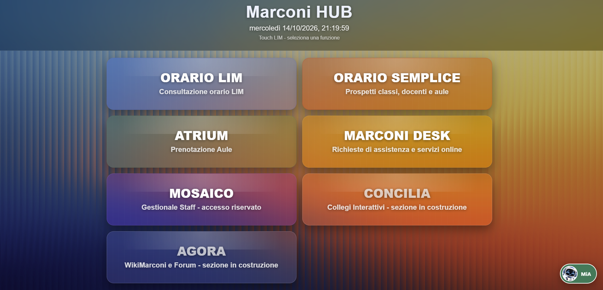
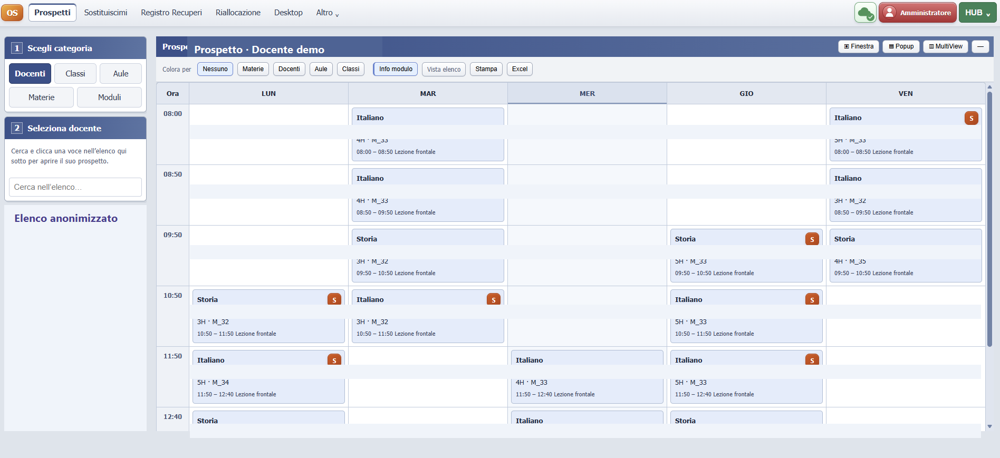
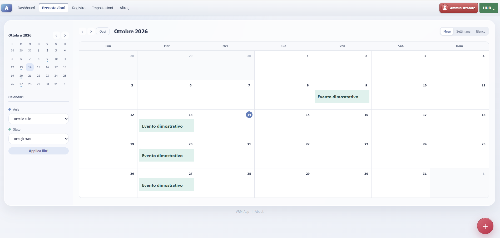
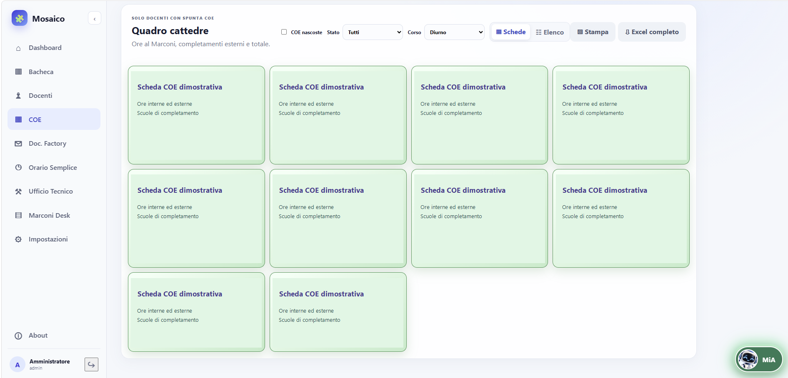
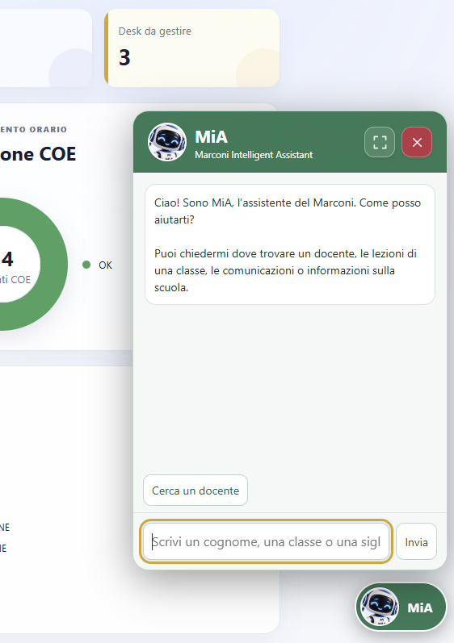
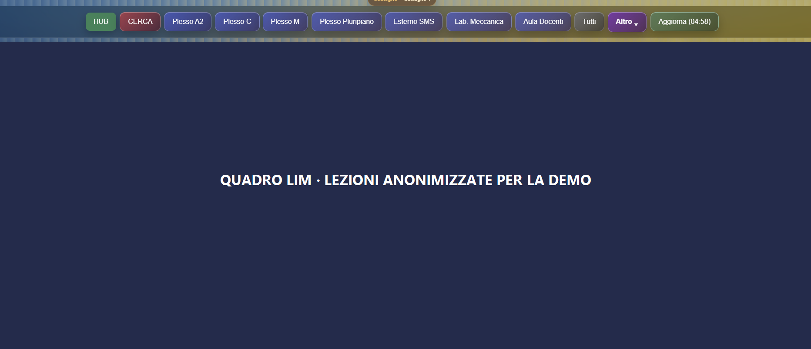

# Marconi HUB

**Una piattaforma digitale modulare progettata per le scuole.**

Marconi HUB riunisce strumenti web per l’organizzazione scolastica, la consultazione dell’orario, la gestione di richieste e spazi e il coordinamento del lavoro. **Mosaico è il punto di governo operativo**: offre allo staff autorizzato le funzioni assegnate e permette agli amministratori di configurare account, ruoli e servizi. La piattaforma è pensata per docenti e personale scolastico, con strumenti di riepilogo utili anche al coordinamento organizzativo.

Il progetto è rivolto alle scuole. È attualmente in uso presso l’I.I.S. “G. Marconi” di Torre Annunziata, che rappresenta il contesto attuale di utilizzo e sviluppo, non il limite della sua destinazione. La pubblicazione presenta il funzionamento senza distribuire codice sorgente. Le schermate sono state preparate per la condivisione: dati personali e contenuti operativi sono stati oscurati o sostituiti con esempi.

Per una descrizione funzionale più ampia, consulta il [PDF di presentazione per le scuole](MarconiHUB_presentazione_scuole.pdf).

## Mosaico: il centro operativo

Mosaico raccoglie dashboard, anagrafica docenti, classi di concorso, stati e archivi annuali, gestione degli account, richieste di registrazione da verificare, bacheche, modelli e collegamenti ai servizi della piattaforma. La dashboard dello staff mostra il riepilogo dei servizi e delle pratiche accessibili al proprio profilo; l’amministrazione può configurare utenti e ruoli.

La bacheca offre lavagne organizzabili come griglia o elenco, note, checklist e collegamenti tra elementi. Le voci selezionate possono essere mostrate nella dashboard, così da rendere più visibili attività e promemoria condivisi.

## Accessi e policy

I profili distinguono amministrazione, staff e docente. Gli amministratori possono creare ruoli per lo staff scegliendo i singoli servizi e assegnare più ruoli agli account. Le autorizzazioni sono quindi modulabili per area, ad esempio Ufficio Tecnico, COE, anagrafica, orario, Desk o Atrium. I docenti usano i servizi previsti per il proprio profilo; l’accesso alle funzioni gestionali viene riservato agli account autorizzati.

La configurazione dei ruoli va definita con la scuola: chi consulta, chi inserisce o modifica, chi prende in carico o valida le richieste e chi amministra gli account. Le autorizzazioni tecniche non sostituiscono le procedure organizzative né la definizione delle responsabilità dell’istituto.

## Servizi

### Orario Semplice e Team Orario

Orario Semplice presenta prospetti per classi, docenti, aule, materie e moduli, con ricerca, filtri, dettagli delle lezioni, colorazione, viste tabellari, stampa ed esportazione. Gli strumenti collegati comprendono disponibilità delle aule, statistiche dell’attività giornaliera, orari di sostegno e serali, gestione di recuperi e altri flussi staff.

In Mosaico il gruppo che predispone l’orario può gestire archivi e periodi di validità, importare i dati, ricercare e modificare singole righe, impostare fasce orarie, notifiche, manutenzione e visualizzazioni. **“Team Orario” descrive qui il gruppo e il suo flusso di lavoro, non un modulo autonomo che nel progetto porti questo nome.**

#### Importazione e compatibilità con i software di orario

Il punto di partenza per l’attivazione è il file esportabile dal software già usato dalla scuola. Mosaico include un importatore per uno specifico formato OFD XML; questo non significa che qualsiasi file `.ofd` o XML sia già compatibile. Per i principali software di gestione dell’orario, la possibilità di esportare i dati in XML costituisce una base utile: formato e tracciato devono essere verificati su un campione e l’eventuale adattamento va concordato prima dell’importazione. La compatibilità dipende dai dati effettivamente esportati.

L’importazione attuale supporta un periodo e una settimana per file OFD e file fino a 20 MB. Le lezioni senza collocazione vengono segnalate e non inserite nella griglia. Si consiglia di verificare sempre il risultato prima di renderlo disponibile come orario in vigore.

### Orario LIM

Pensato per lavagne interattive e monitor condivisi, mostra per le classi la lezione in corso e quella successiva, con materia, aula e fascia oraria. Le viste possono essere filtrate per plesso o area. Dalla LIM si può consultare l’occupazione e cercare aule libere indicando plesso, giorno e fascia oraria; è possibile filtrare per mostrare solo gli spazi disponibili. Questo aiuta docenti e personale a individuare un’aula per un’attività o uno spostamento senza ricostruire manualmente il quadro del plesso.

### Segreteria e convocazione del personale

La consultazione dell’orario e dei dati di servizio può aiutare la segreteria a verificare disponibilità e contesto durante la convocazione del personale. Accessi e informazioni visibili vanno assegnati in modo mirato secondo la policy dell’istituto. Marconi HUB supporta la reperibilità del quadro informativo; eventuali invii o procedure automatiche di convocazione vanno verificati e concordati in fase di configurazione.

### Gestione COE

La sezione COE mette in relazione le ore svolte nell’istituto, i completamenti presso altre scuole e il totale della cattedra. Per ogni situazione consente di consultare sedi, giorni e stato del completamento; offre viste a schede o elenco, stampa ed esportazione. La rubrica delle scuole esterne supporta l’organizzazione dei riferimenti utilizzati dal gruppo incaricato.

### Ufficio Tecnico

L’Ufficio Tecnico raccoglie richieste attraverso un modulo e permette al personale incaricato di seguirne la lavorazione. Il modulo può essere personalizzato nei campi, nell’ordine e nell’obbligatorietà delle domande. Le richieste si possono cercare e filtrare per stato, luogo, classe di concorso, laboratorio e data, visualizzare in tabella o griglia, aprire nel dettaglio e stampare o salvare in PDF scegliendo righe e colonne.

Gli stati rendono visibile l’avanzamento, ad esempio dalla fase di accettazione a quella di lavorazione fino all’evasione o al rifiuto. Le notifiche email per i nuovi invii possono essere configurate con destinatari, oggetto e testo personalizzabili. Il flusso aiuta a riunire le segnalazioni, ridurre la dispersione tra canali e chiarire la presa in carico, secondo la procedura scelta dall’istituto.

### Marconi Desk

Desk gestisce moduli scolastici, pagine e risposte. I moduli possono raccogliere diversi tipi di campi, essere organizzati e attivati secondo necessità; le risposte sono consultabili e aggiornabili tramite stati. Sono disponibili viste amministrative e flussi specifici, tra cui la raccolta delle registrazioni dei nuovi docenti.

### Atrium

Atrium supporta prenotazione e gestione di aule e spazi, con calendario mensile, settimanale ed elenco. Il sistema considera disponibilità e sovrapposizioni e può collegare agli ambienti attrezzature, referenti e vincoli di utilizzo. Le impostazioni del calendario e delle risorse si adattano al contesto configurato per la scuola.

### Bacheca, documenti e account

Le bacheche digitali supportano note e checklist condivise. Doc. Factory raccoglie modelli di email e comunicazioni, con campi variabili collegati ai dati previsti. Le funzioni di gestione account comprendono registrazioni da verificare, associazione degli account ai docenti e modelli di comunicazione per i flussi configurati.

### Recuperi, sostegno e assistente MiA

Il Registro Recuperi supporta la registrazione di permessi brevi e ore da recuperare, con stati, scadenze e validazioni secondo i permessi assegnati. Referenti di plesso e personale incaricato possono ricevere accesso alla gestione in base ai ruoli configurati. Le registrazioni possono conservare il contesto operativo delle ore collegate alle sostituzioni.

Orario Semplice include una simulazione di sostituzione che può proporre candidati considerando compresenze, sostegno programmato, docenti di potenziamento e ore libere compatibili. La proposta è modificabile e stampabile; criteri e priorità vanno adattati alle regole della scuola. La gestione condivisa e persistente del flusso è un’area in sviluppo/configurazione. È inoltre possibile valutare una schermata pubblica con il quadro delle sostituzioni del giorno, esponendo solo le informazioni approvate dall’istituto.

Gli strumenti di sostegno sono collegati alla consultazione dell’orario.

MiA è un assistente informativo integrato, che usa l’orario, le informazioni e il vocabolario predisposti per rispondere a domande circoscritte, ad esempio su lezioni, classi, docenti e luoghi. Le risposte dipendono dai dati disponibili e non sostituiscono le comunicazioni ufficiali.

## Installazione locale e uso offline

La piattaforma può essere valutata per l’installazione nell’infrastruttura locale della scuola. Server, rete, accessi, aggiornamenti, backup e responsabilità operative vanno definiti con i referenti dell’istituto durante il percorso di attivazione.

Orario Semplice è predisposto come applicazione web installabile (PWA) su dispositivi e browser compatibili: computer, tablet, smartphone e LIM. Gli aggiornamenti vengono distribuiti attraverso il browser e il service worker, senza reinstallare manualmente un pacchetto per ogni rilascio; quando richiesto, l’utente può confermare l’aggiornamento disponibile. Dopo l’accesso e la preparazione sul dispositivo, alcune viste e risorse già salvate possono rimanere disponibili offline; se è abilitata la sincronizzazione, alcune modifiche possono essere accodate e inviate al ritorno della connessione. La disponibilità dipende dal dispositivo, dal browser, dalla sessione e dai contenuti già preparati. **La modalità offline riguarda Orario Semplice e non significa che tutti i servizi HUB funzionino senza rete.**

## Vantaggi per l’organizzazione scolastica

- Un punto di accesso comune aiuta a ritrovare servizi e informazioni.
- Moduli, code e stati rendono più leggibili i passaggi tra invio e presa in carico.
- I ruoli configurabili permettono di assegnare funzioni in base alle responsabilità operative.
- L’orario alimenta prospetti, schermi e strumenti di consultazione collegati.
- Dashboard, bacheche e viste di lavoro aiutano il coordinamento tra gruppi e uffici.
- L’attivazione può essere graduale, partendo dai servizi prioritari per la scuola.

## Personalizzazione e collaborazione

Il nome e l’identità mostrati nell’interfaccia possono essere adattati alla scuola. La piattaforma è modulare e può essere discussa per estensioni o strumenti dedicati a processi specifici dei diversi istituti. Moduli aggiuntivi, integrazioni e modalità di attivazione si definiscono con ciascuna scuola, chiarendo ambito, dati, ruoli, infrastruttura, responsabilità e manutenzione.

Sono disponibile a confrontarmi con scuole interessate a conoscere Marconi HUB, valutarne l’adattamento o discutere un possibile percorso di attivazione. Il progetto è ideato e curato da **Vincenzo Rosario Mellone**.

Per avviare un confronto: [info@vr-m.it](mailto:info@vr-m.it) · [vr-m.it](https://www.vr-m.it/).

## Schermate dimostrative

Le immagini mostrano l’interfaccia e alcuni flussi. I nominativi e i dati personali sono stati oscurati; le schede COE e gli eventi Atrium usano contenuti dimostrativi.

*Home della piattaforma, attualmente in uso al Marconi.*

*Prospetto settimanale con nominativi anonimizzati.*

*Agenda per consultare e gestire la prenotazione degli spazi.*

*Vista COE: le schede reali sono state sostituite con contenuti dimostrativi.*

*Esempio dell’assistente informativo integrato.*

*Schermata di consultazione per LIM e display condivisi.*

## Codice e condivisione

Questa pubblicazione illustra il progetto senza distribuire il codice sorgente. Eventuali forme di riuso, adattamento o condivisione tecnica saranno concordate separatamente, chiarendo titolarità, autorizzazioni e condizioni di gestione.

---

*Le funzioni e le configurazioni possono evolvere. Compatibilità dei flussi, servizi richiesti e modalità di installazione vanno verificati con la scuola interessata.*
